# Relatório da Parte Específica - Diabetes e reinternação hospitalar

## 1. Pergunta, público e resposta

**Pergunta:** Quanto mais vezes o paciente foi internado no ano anterior, e quanto mais vezes foi à emergência, maior a chance de voltar ao hospital em menos de 30 dias? Isso vale para cada um separadamente e para os dois combinados? E o padrão se mantém quando olhamos só os pacientes que foram reinternados em algum momento?

1. Quanto maior o número de internações no ano anterior (0, 1, 2, 3 ou mais), maior a taxa de reinternação em menos de 30 dias? E quanto maior o número de idas à emergência? (X1 e X2)

2. Quando o paciente tem as duas coisas ao mesmo tempo, internações e emergências, o risco é ainda maior? (M2)

3. Esses padrões se mantêm quando olhamos apenas os pacientes que foram reinternados em algum momento (sem as linhas NO)? (C1)

**Público-alvo:** Gestores de qualidade hospitalar e analistas de dados que precisam decidir quais pacientes devem receber acompanhamento depois da alta. O texto evita jargão estatístico e sempre mostra o denominador de cada taxa.

Sim, nas três partes da pergunta. (1) Separadamente: a taxa de reinternação em menos de 30 dias sobe de 8,4% para 25,7% conforme aumentam as internações prévias e de 10,5% para 24,9% conforme aumentam as emergências prévias. (2) Combinados: quem tem 3 ou mais internações e 3 ou mais emergências volta em 33,4% dos casos, quatro vezes mais que quem não tem nenhum dos dois históricos (8,3%). As internações prévias pesam mais que as emergências. (3) Só entre os reinternados: o padrão se mantém, mas mais fraco. As taxas vão de 21,9% a 34,4% por internações e de 23,9% a 31,8% por emergências. O histórico indica não só se o paciente volta, mas também se volta rápido. Para as internações prévias, o resultado também se sustenta com uma linha por paciente e sem as altas por óbito ou hospice: com 3 ou mais internações, a taxa fica entre 25,8% e 26,5%.

O passado hospitalar é o sinal mais claro de reinternação rápida nesta base. Um paciente que esteve internado três ou mais vezes no ano anterior tem cerca de uma chance em quatro de voltar antes de completar um mês da alta. Para quem não teve internação, a chance é de uma em doze. Essa informação já está disponível no momento da admissão.

## 2. Dados, unidade de análise e estrutura

Base: 101.766 internações, 71.518 pacientes, 50 atributos originais. São 11.357 registros <30 dias (11,16%). Cada linha é uma internação. A classe positiva é estritamente o rótulo <30; >30 e NO formam o complemento nas proporções binárias.

A fonte é o conjunto UCI [1]. O CSV original permanece intacto, e o SHA-256 está em resumo.json. A tabela abaixo distingue tipo de armazenamento e tipo semântico.

| atributo | dtype_python | tipo_semantico | papel | descricao | valores_distintos | ausentes_interrogacao | ausentes_pct | exemplos |
| --- | --- | --- | --- | --- | --- | --- | --- | --- |
| encounter_id | int64 | Identificador | ID | Identificador da internação; não é medida quantitativa. | 101766 | 0 | 0.000 | 2278392 / 149190 / 64410 / 500364 |
| patient_nbr | int64 | Identificador | ID | Identificador do paciente; permite reconhecer registros repetidos. | 71518 | 0 | 0.000 | 8222157 / 55629189 / 86047875 / 82442376 |
| race | object | Categórica nominal | Atributo | Categoria demográfica registrada na fonte. | 5 | 2273 | 2.234 | Caucasian / AfricanAmerican / Other / Asian |
| gender | object | Categórica nominal | Atributo | Sexo registrado; Unknown/Invalid é categoria sem informação válida. | 3 | 0 | 0.000 | Female / Male / Unknown/Invalid |
| age | object | Categórica ordinal em intervalos | Atributo | Faixa etária ordinal de dez anos. | 10 | 0 | 0.000 | [0-10) / [10-20) / [20-30) / [30-40) |
| weight | object | Categórica ordinal em intervalos | Atributo | Faixa de peso em kg (limites convertidos de libras e arredondados); não é um peso pontual. | 9 | 98569 | 96.859 | [34-45) / [23-34) / [0-11) / [45-57) |
| admission_type_id | int64 | Categórica nominal | Atributo | Código nominal do tipo de admissão. | 8 | 0 | 0.000 | 6 / 1 / 2 / 3 |
| discharge_disposition_id | int64 | Categórica nominal | Atributo | Código nominal do destino na alta. | 26 | 0 | 0.000 | 25 / 1 / 3 / 6 |
| admission_source_id | int64 | Categórica nominal | Atributo | Código nominal da origem da admissão. | 17 | 0 | 0.000 | 1 / 7 / 2 / 4 |
| time_in_hospital | int64 | Quantitativa discreta | Atributo | Permanência (dias) | 14 | 0 | 0.000 | 1 / 3 / 2 / 4 |
| payer_code | object | Categórica nominal | Atributo | Categoria de pagador registrada. | 17 | 40256 | 39.557 | MC / MD / HM / UN |
| medical_specialty | object | Categórica nominal | Atributo | Especialidade médica registrada. | 72 | 49949 | 49.082 | Pediatrics-Endocrinology / InternalMedicine / Family/GeneralPractice / Cardiology |
| num_lab_procedures | int64 | Quantitativa discreta | Atributo | Exames laboratoriais | 118 | 0 | 0.000 | 41 / 59 / 11 / 44 |
| num_procedures | int64 | Quantitativa discreta | Atributo | Procedimentos | 7 | 0 | 0.000 | 0 / 5 / 1 / 6 |
| num_medications | int64 | Quantitativa discreta | Atributo | Medicamentos | 75 | 0 | 0.000 | 1 / 18 / 13 / 16 |
| number_outpatient | int64 | Quantitativa discreta | Atributo | Consultas ambulatoriais prévias | 39 | 0 | 0.000 | 0 / 2 / 1 / 5 |
| number_emergency | int64 | Quantitativa discreta | Atributo | Emergências prévias | 33 | 0 | 0.000 | 0 / 1 / 2 / 4 |
| number_inpatient | int64 | Quantitativa discreta | Atributo | Internações prévias | 21 | 0 | 0.000 | 0 / 1 / 2 / 3 |
| diag_1 | object | Categórica nominal | Atributo | Código textual do diagnóstico principal (ICD-9-CM). | 716 | 21 | 0.021 | 250.83 / 276 / 648 / 8 |
| diag_2 | object | Categórica nominal | Atributo | Código textual do diagnóstico secundário (ICD-9-CM). | 748 | 358 | 0.352 | 250.01 / 250 / 250.43 / 157 |
| diag_3 | object | Categórica nominal | Atributo | Código textual do diagnóstico adicional (ICD-9-CM). | 789 | 1423 | 1.398 | 255 / V27 / 403 / 250 |
| number_diagnoses | int64 | Quantitativa discreta | Atributo | Diagnósticos | 16 | 0 | 0.000 | 1 / 9 / 6 / 7 |
| max_glu_serum | object | Categórica nominal | Atributo | Categoria do teste de glicose; None significa não medido. | 4 | 0 | 0.000 | None / >300 / Norm / >200 |
| A1Cresult | object | Categórica nominal | Atributo | Categoria de HbA1c; None significa não medido. | 4 | 0 | 0.000 | None / >7 / >8 / Norm |
| metformin | object | Categórica nominal | Atributo | Situação de uso e alteração de dose de metformin. | 4 | 0 | 0.000 | No / Steady / Up / Down |
| repaglinide | object | Categórica nominal | Atributo | Situação de uso e alteração de dose de repaglinide. | 4 | 0 | 0.000 | No / Up / Steady / Down |
| nateglinide | object | Categórica nominal | Atributo | Situação de uso e alteração de dose de nateglinide. | 4 | 0 | 0.000 | No / Steady / Down / Up |
| chlorpropamide | object | Categórica nominal | Atributo | Situação de uso e alteração de dose de chlorpropamide. | 4 | 0 | 0.000 | No / Steady / Down / Up |
| glimepiride | object | Categórica nominal | Atributo | Situação de uso e alteração de dose de glimepiride. | 4 | 0 | 0.000 | No / Steady / Down / Up |
| acetohexamide | object | Categórica nominal | Atributo | Situação de uso e alteração de dose de acetohexamide. | 2 | 0 | 0.000 | No / Steady |
| glipizide | object | Categórica nominal | Atributo | Situação de uso e alteração de dose de glipizide. | 4 | 0 | 0.000 | No / Steady / Up / Down |
| glyburide | object | Categórica nominal | Atributo | Situação de uso e alteração de dose de glyburide. | 4 | 0 | 0.000 | No / Steady / Up / Down |
| tolbutamide | object | Categórica nominal | Atributo | Situação de uso e alteração de dose de tolbutamide. | 2 | 0 | 0.000 | No / Steady |
| pioglitazone | object | Categórica nominal | Atributo | Situação de uso e alteração de dose de pioglitazone. | 4 | 0 | 0.000 | No / Steady / Up / Down |
| rosiglitazone | object | Categórica nominal | Atributo | Situação de uso e alteração de dose de rosiglitazone. | 4 | 0 | 0.000 | No / Steady / Up / Down |
| acarbose | object | Categórica nominal | Atributo | Situação de uso e alteração de dose de acarbose. | 4 | 0 | 0.000 | No / Steady / Up / Down |
| miglitol | object | Categórica nominal | Atributo | Situação de uso e alteração de dose de miglitol. | 4 | 0 | 0.000 | No / Steady / Down / Up |
| troglitazone | object | Categórica nominal | Atributo | Situação de uso e alteração de dose de troglitazone. | 2 | 0 | 0.000 | No / Steady |
| tolazamide | object | Categórica nominal | Atributo | Situação de uso e alteração de dose de tolazamide. | 3 | 0 | 0.000 | No / Steady / Up |
| examide | object | Categórica nominal | Atributo | Situação de uso e alteração de dose de examide. | 1 | 0 | 0.000 | No |
| citoglipton | object | Categórica nominal | Atributo | Situação de uso e alteração de dose de citoglipton. | 1 | 0 | 0.000 | No |
| insulin | object | Categórica nominal | Atributo | Situação de uso e alteração de dose de insulin. | 4 | 0 | 0.000 | No / Up / Steady / Down |
| glyburide-metformin | object | Categórica nominal | Atributo | Situação de uso e alteração de dose de glyburide-metformin. | 4 | 0 | 0.000 | No / Steady / Down / Up |
| glipizide-metformin | object | Categórica nominal | Atributo | Situação de uso e alteração de dose de glipizide-metformin. | 2 | 0 | 0.000 | No / Steady |
| glimepiride-pioglitazone | object | Categórica nominal | Atributo | Situação de uso e alteração de dose de glimepiride-pioglitazone. | 2 | 0 | 0.000 | No / Steady |
| metformin-rosiglitazone | object | Categórica nominal | Atributo | Situação de uso e alteração de dose de metformin-rosiglitazone. | 2 | 0 | 0.000 | No / Steady |
| metformin-pioglitazone | object | Categórica nominal | Atributo | Situação de uso e alteração de dose de metformin-pioglitazone. | 2 | 0 | 0.000 | No / Steady |
| change | object | Categórica nominal | Atributo | Indicador de mudança da medicação de diabetes. | 2 | 0 | 0.000 | No / Ch |
| diabetesMed | object | Categórica nominal | Atributo | Indicador de medicação para diabetes. | 2 | 0 | 0.000 | No / Yes |
| readmitted | object | Categórica nominal - alvo | Alvo | Rótulo original: <30, >30 ou NO; NO significa ausência de registro de reinternação. | 3 | 0 | 0.000 | NO / >30 / <30 |

## 3. Qualidade e inconsistências

A auditoria não encontrou linhas inteiramente duplicadas nem encounter_id repetido: cada linha é uma internação única. Há 30.248 linhas de pacientes que já aparecem em outra internação (71.518 pacientes para 101.766 internações). Isso não é erro, é a própria estrutura da base, e por isso essas linhas foram mantidas. A repetição de pacientes é avaliada na análise de sensibilidade da seção 8. Os domínios numéricos estão dentro do esperado (permanência entre 1 e 14 dias, contagens inteiras e não negativas). Os códigos de diagnóstico com formato fora do padrão ICD-9 (2.646 em diag_1, 1.560 em diag_2 e 1.526 em diag_3) são códigos de 1 ou 2 dígitos, como "38" e "8", que parecem ter perdido o zero à esquerda ("038" é septicemia). Eles foram apenas sinalizados: o formato sozinho não permite afirmar que o diagnóstico esteja errado.

| verificacao | ocorrencias | tipo |
| --- | --- | --- |
| Registros adicionais de pacientes já presentes | 30248 | Estrutura |
| Formato ICD-9 não usual: diag_1 | 2646 | Verificação |
| Formato ICD-9 não usual: diag_2 | 1560 | Verificação |
| Formato ICD-9 não usual: diag_3 | 1526 | Verificação |
| Sexo Unknown/Invalid | 3 | Categoria sem informação |

## 4. Mecanismos de ausência e tratamento

A base tem quatro tipos de informação faltante, e cada um foi tratado de forma diferente: o marcador "?" (falta de registro), a categoria Unknown/Invalid em gender (3 internações), os códigos administrativos que significam "sem informação" (por exemplo, admission_type_id 5, 6 e 8, que somam 10,2%) e o valor None nos exames de HbA1c e glicose. O None não é falta de dado: indica que o exame não foi feito. As ausências mais graves estão em weight (96,9%), medical_specialty (49,1%) e payer_code (39,6%). Em race (2,2%) e nos diagnósticos (até 1,4%) elas são pequenas.

weight (96,9%): Hipótese: o peso não era coletado de forma rotineira no sistema de origem. A falta depende do processo de registro, e não do paciente. A proporção de ausentes é quase igual nos três desfechos (95,8% a 97,6%) e em todas as faixas etárias, por isso a ausência pouco informa sobre a reinternação. Decisão: não imputar e não usar o peso como medida, porque restam só 3.197 registros com valor.

medical_specialty (49,1%): Hipótese: ausência dependente de outras variáveis (MAR). A falta cresce com a idade (17,4% de 0 a 10 anos e 52,3% de 80 a 90) e é um pouco menor entre quem não foi reinternado (47,3%, contra 50,9% em <30). Provavelmente reflete o tipo de admissão e a rotina de cada hospital. Decisão: manter as linhas e usar "Não informado" como categoria explícita, para não perder metade da base.

payer_code (39,6%): Hipótese: MAR ligado à idade e ao tipo de cobertura. A falta é de 91,3% entre 0 e 10 anos e cai para 28,4% acima de 90 anos, o que é coerente com a cobertura pública dos mais velhos (Medicare, código MC, é o pagador mais frequente da base). Quase não varia entre os desfechos (38,9% a 40,7%). Decisão: manter como "Não informado".

race (2,2%): Hipótese: falha de registro no cadastro. A falta é um pouco maior entre quem não foi reinternado (2,8%, contra 1,7% em <30). Como o volume é pequeno, a categoria "Não informado" foi mantida.

diag_1, diag_2 e diag_3 (0,02% a 1,4%): Hipótese: ausência estrutural. O diagnóstico secundário ou adicional falta quando o paciente teve menos diagnósticos registrados. O mapa de calor mostra que, das 358 internações sem diag_2, 279 também não têm diag_3. Decisão: manter e tratar como "Não informado", sem inventar diagnóstico.

A1Cresult (83,3%) e max_glu_serum (94,7%) = None: Não é ausência: o exame não foi feito, e isso tem significado clínico (é a pergunta do artigo original). Decisão: manter None como categoria própria.

Ausências conjuntas: Os mapas de calor mostram que as ausências não se concentram nas mesmas internações. Sem payer_code, 40,6% não têm especialidade, e com payer_code, 54,6% não têm. Isso afasta a ideia de um "bloco" de registros incompletos, que poderia ser excluído de uma só vez.

Os dados permitem verificar só se a falta muda com variáveis observadas (idade e desfecho). Não é possível provar MCAR, MAR ou MNAR, por isso as classificações acima são hipóteses. Em todos os casos, a decisão foi preservar as linhas, para não mudar a composição da base.

| atributo | tipo | n | percentual |
| --- | --- | --- | --- |
| race | Marcador ? | 2273 | 2.23% |
| weight | Marcador ? | 98569 | 96.86% |
| payer_code | Marcador ? | 40256 | 39.56% |
| medical_specialty | Marcador ? | 49949 | 49.08% |
| diag_1 | Marcador ? | 21 | 0.02% |
| diag_2 | Marcador ? | 358 | 0.35% |
| diag_3 | Marcador ? | 1423 | 1.40% |
| gender | Unknown/Invalid | 3 | 0.00% |
| admission_type_id | Código sem informação | 10396 | 10.22% |
| discharge_disposition_id | Código sem informação | 4680 | 4.60% |
| admission_source_id | Código sem informação | 7067 | 6.94% |
| A1Cresult | None (exame) | 84748 | 83.28% |
| max_glu_serum | None (exame) | 96420 | 94.75% |

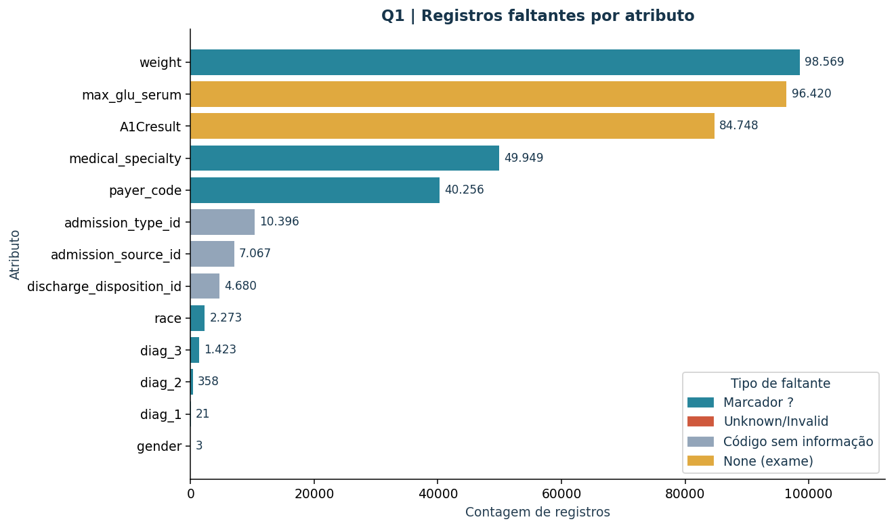

Os padrões estratificados completos estão em out/parte_especifica/padroes_ausencia.csv.

## 5. Outliers: identificação, avaliação e decisão

A regra do IQR sinaliza 45.358 ocorrências somando os oito atributos (a mesma internação pode ser contada mais de uma vez). Nas consultas ambulatoriais e nas emergências o IQR é zero, porque mais da metade das internações tem valor 0, e qualquer valor positivo vira "outlier" (16,4% e 11,2% das linhas). Em internações prévias o limite superior é 2,5. Assim, todo paciente com 3 ou mais internações seria sinalizado (6,9%), e esse é justamente o grupo com a maior taxa de reinternação em menos de 30 dias (25,7%). Remover esses casos apagaria o contraste que a pergunta quer estudar. Os valores também são plausíveis: a permanência fica entre 1 e 14 dias, e contagens altas de emergência correspondem a pacientes que usam muito o serviço. Decisão: preservar todos os valores e usar o IQR apenas como triagem.

Extremos simultâneos (medicamentos × internações prévias): Tabela cruzada e mapa de calor das internações que passam do limite superior do IQR em medicamentos (mais de 35) e em internações prévias (mais de 2,5, ou seja, 3 ou mais). Só 118 internações são extremas nas duas variáveis ao mesmo tempo. Os extremos não aparecem juntos. Entre as internações com muitos medicamentos, 4,6% também têm 3 ou mais internações prévias, contra 7,0% nas demais. Se os extremos fossem erro sistemático de digitação ou de carga, esperaríamos que se acumulassem nas mesmas linhas. Eles também se comportam de forma diferente em relação ao desfecho. A taxa de reinternação em menos de 30 dias é de 25,7% quando só o histórico é extremo, 11,5% quando só os medicamentos são extremos e 10,0% quando nenhum é. O histórico extremo carrega informação, por isso foi mantido.

| atributo | min | q1 | mediana | q3 | max | iqr | limite_inferior | limite_superior | sinalizados_iqr | sinalizados_pct | p99 | acima_p99 |
| --- | --- | --- | --- | --- | --- | --- | --- | --- | --- | --- | --- | --- |
| time_in_hospital | 1.000 | 2.000 | 4.000 | 6.000 | 14.000 | 4.000 | -4.000 | 12.000 | 2252 | 2.213 | 14.000 | 0 |
| num_lab_procedures | 1.000 | 31.000 | 44.000 | 57.000 | 132.000 | 26.000 | -8.000 | 96.000 | 143 | 0.141 | 85.000 | 886 |
| num_procedures | 0.000 | 0.000 | 1.000 | 2.000 | 6.000 | 2.000 | -3.000 | 5.000 | 4954 | 4.868 | 6.000 | 0 |
| num_medications | 1.000 | 10.000 | 15.000 | 20.000 | 81.000 | 10.000 | -5.000 | 35.000 | 2557 | 2.513 | 43.000 | 960 |
| number_outpatient | 0.000 | 0.000 | 0.000 | 0.000 | 42.000 | 0.000 | 0.000 | 0.000 | 16739 | 16.449 | 5.000 | 924 |
| number_emergency | 0.000 | 0.000 | 0.000 | 0.000 | 76.000 | 0.000 | 0.000 | 0.000 | 11383 | 11.185 | 3.000 | 939 |
| number_inpatient | 0.000 | 0.000 | 0.000 | 1.000 | 21.000 | 1.000 | -1.500 | 2.500 | 7049 | 6.927 | 6.000 | 724 |
| number_diagnoses | 1.000 | 6.000 | 8.000 | 9.000 | 16.000 | 3.000 | 1.500 | 13.500 | 281 | 0.276 | 9.000 | 115 |

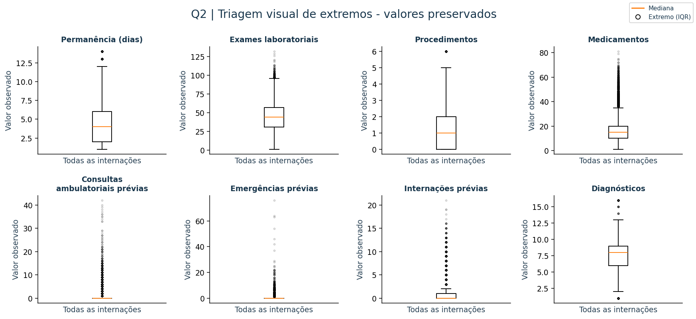

## 6. Distribuições de todos os atributos

As distribuições mostram uma base concentrada em pacientes idosos (47,7% entre 60 e 80 anos) e mulheres (53,8%), com internações curtas (mediana de 4 dias) e cerca de 15 medicamentos. As contagens de histórico têm muitos zeros. Nas variáveis categóricas, a maior parte dos 23 medicamentos quase não varia (mais de 99% "No" em vários deles, e examide e citoglipton têm uma única categoria). Os exames HbA1c e glicose quase sempre aparecem como "não realizados". O desfecho se divide em 53,9% NO, 34,9% >30 e 11,2% <30: a classe de interesse é minoritária, por isso comparamos proporções e não contagens absolutas.

Emergências prévias (skewness 22,86 e kurtosis 1.191,7): a distribuição mais extrema da base. 88,8% das internações têm zero emergências, e poucos pacientes chegam a dezenas (máximo de 76). A média (0,20) não representa o paciente típico.

Consultas ambulatoriais prévias (skewness 8,83 e kurtosis 147,9): mesmo padrão: 83,6% de zeros e uma cauda longa à direita (máximo de 42).

Internações prévias (skewness 3,61 e kurtosis 20,7): assimetria forte, mas menor. 66,5% não tiveram internação no ano anterior, e a cauda chega a 21. É a variável central da pergunta, por isso foi agrupada em 0, 1, 2 e 3 ou mais.

Medicamentos (skewness 1,33 e kurtosis 3,47): assimetria moderada à direita, com mediana de 15 e alguns casos acima de 35.

Permanência e procedimentos (skewness 1,13 e 1,32; kurtosis 0,85 e 0,86): assimetria moderada e caudas leves. Os valores são limitados pelo próprio domínio (1 a 14 dias e 0 a 6 procedimentos).

Exames laboratoriais (skewness -0,24 e kurtosis -0,25): quase simétrica, com média (43,1) e mediana (44) próximas.

Diagnósticos (skewness -0,88 e kurtosis -0,08): assimetria à esquerda: os valores se acumulam no teto de 9 diagnósticos (48,6% das internações), e só 0,1% passa disso.

A kurtosis apresentada é o excesso de curtose (o valor da normal é 0). Nas três contagens de histórico, a média é puxada pela cauda, então descrevemos essas variáveis por mediana, percentis e grupos. Os coeficientes de Spearman foram mantidos ao lado dos de Pearson porque não dependem da forma da distribuição.

| atributo | count | mean | std | min | 1% | 25% | 50% | 75% | 95% | 99% | max |
| --- | --- | --- | --- | --- | --- | --- | --- | --- | --- | --- | --- |
| time_in_hospital | 101766.000 | 4.396 | 2.985 | 1.000 | 1.000 | 2.000 | 4.000 | 6.000 | 11.000 | 14.000 | 14.000 |
| num_lab_procedures | 101766.000 | 43.096 | 19.674 | 1.000 | 1.000 | 31.000 | 44.000 | 57.000 | 73.000 | 85.000 | 132.000 |
| num_procedures | 101766.000 | 1.340 | 1.706 | 0.000 | 0.000 | 0.000 | 1.000 | 2.000 | 5.000 | 6.000 | 6.000 |
| num_medications | 101766.000 | 16.022 | 8.128 | 1.000 | 3.000 | 10.000 | 15.000 | 20.000 | 31.000 | 43.000 | 81.000 |
| number_outpatient | 101766.000 | 0.369 | 1.267 | 0.000 | 0.000 | 0.000 | 0.000 | 0.000 | 2.000 | 5.000 | 42.000 |
| number_emergency | 101766.000 | 0.198 | 0.930 | 0.000 | 0.000 | 0.000 | 0.000 | 0.000 | 1.000 | 3.000 | 76.000 |
| number_inpatient | 101766.000 | 0.636 | 1.263 | 0.000 | 0.000 | 0.000 | 0.000 | 1.000 | 3.000 | 6.000 | 21.000 |
| number_diagnoses | 101766.000 | 7.423 | 1.934 | 1.000 | 2.000 | 6.000 | 8.000 | 9.000 | 9.000 | 9.000 | 16.000 |

| atributo | valor | n | percentual |
| --- | --- | --- | --- |
| A1Cresult | None | 84748 | 83.277 |
| acarbose | No | 101458 | 99.697 |
| acetohexamide | No | 101765 | 99.999 |
| admission_source_id | 7 | 57494 | 56.496 |
| admission_type_id | 1 | 53990 | 53.053 |
| age | [70-80) | 26068 | 25.616 |
| change | No | 54755 | 53.805 |
| chlorpropamide | No | 101680 | 99.915 |
| citoglipton | No | 101766 | 100.000 |
| diabetesMed | Yes | 78363 | 77.003 |
| diag_1 | 428 | 6862 | 6.743 |
| diag_2 | 276 | 6752 | 6.635 |
| diag_3 | 250 | 11555 | 11.354 |
| discharge_disposition_id | 1 | 60234 | 59.189 |
| examide | No | 101766 | 100.000 |
| gender | Female | 54708 | 53.759 |
| glimepiride | No | 96575 | 94.899 |
| glimepiride-pioglitazone | No | 101765 | 99.999 |
| glipizide | No | 89080 | 87.534 |
| glipizide-metformin | No | 101753 | 99.987 |
| glyburide | No | 91116 | 89.535 |
| glyburide-metformin | No | 101060 | 99.306 |
| insulin | No | 47383 | 46.561 |
| max_glu_serum | None | 96420 | 94.747 |
| medical_specialty | Não informado | 49949 | 49.082 |
| metformin | No | 81778 | 80.359 |
| metformin-pioglitazone | No | 101765 | 99.999 |
| metformin-rosiglitazone | No | 101764 | 99.998 |
| miglitol | No | 101728 | 99.963 |
| nateglinide | No | 101063 | 99.309 |
| payer_code | Não informado | 40256 | 39.557 |
| pioglitazone | No | 94438 | 92.799 |
| race | Caucasian | 76099 | 74.778 |
| readmitted | NO | 54864 | 53.912 |
| repaglinide | No | 100227 | 98.488 |
| rosiglitazone | No | 95401 | 93.745 |
| tolazamide | No | 101727 | 99.962 |
| tolbutamide | No | 101743 | 99.977 |
| troglitazone | No | 101763 | 99.997 |
| weight | Não informado | 98569 | 96.858 |

## 7. Relações multivariadas e sensibilidades

O catálogo de relações inclui os 47 atributos originais que não são IDs nem o próprio alvo. Para medidas numéricas, há médias e medianas por desfecho; para categorias, contagens e proporções <30 dias. Pearson e Spearman são calculados separadamente. M1 cruza idade, histórico de internações e desfecho; M2 cruza internações prévias, emergências prévias e desfecho. Cada célula tem denominador e numerador exportados. A apresentação é descritiva, sem equiparar correlação, estratificação ou associação a efeito causal.

Na base integral: em quase todas as faixas etárias, a taxa sobe da esquerda para a direita, de 0 até 3 ou mais internações prévias. Entre 70 e 80 anos, por exemplo, vai de 9,6% para 23,5%. O efeito do histórico não é explicado pela idade. As células mais escuras (41,6% entre 20 e 30 anos com 3 ou mais) têm denominadores pequenos e devem ser lidas com cautela.

Na base integral: os dois históricos somam risco. Quem não teve internação nem emergência no ano anterior volta em menos de 30 dias em 8,3% dos casos. Com 3 ou mais internações e 3 ou mais emergências, a taxa é de 33,4% (n=752), quatro vezes maior. As internações prévias pesam mais: sem nenhuma emergência, a taxa já vai de 8,3% para 23,4% quando as internações passam de 0 para 3 ou mais. As emergências acrescentam um efeito menor e menos regular (na linha de 2 internações, a taxa oscila entre 15,2% e 20,5%).

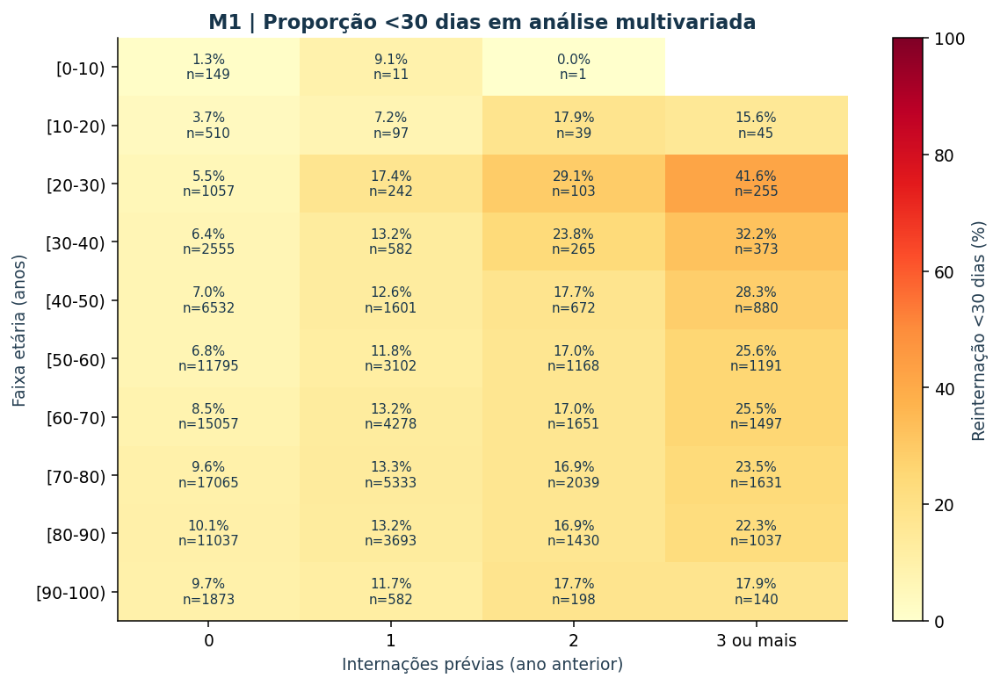

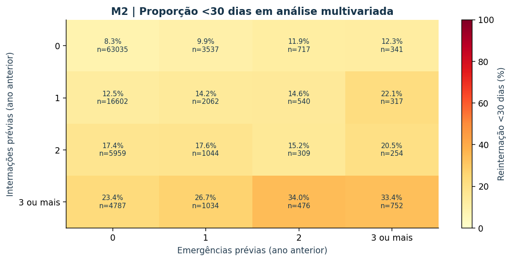

A comparação inclui quatro coortes: todas as internações; uma linha por paciente pelo menor encounter_id; exclusão de altas por óbito/hospice (códigos 11, 13, 14, 19, 20 e 21); e a combinação das duas escolhas. A base integral é o ponto de partida, e os outros recortes mostram a dependência dos resultados das decisões de seleção. Não se afirma que a seleção pelo ID reconstrua a primeira internação em ordem temporal nem que reproduza exatamente a coorte do artigo.

| coorte | variavel | grupo | n | casos | taxa | percentual |
| --- | --- | --- | --- | --- | --- | --- |
| Todas as internações | number_inpatient | 0 | 67630 | 5706 | 0.084 | 8.437 |
| Todas as internações | number_inpatient | 1 | 19521 | 2523 | 0.129 | 12.925 |
| Todas as internações | number_inpatient | 2 | 7566 | 1319 | 0.174 | 17.433 |
| Todas as internações | number_inpatient | 3 ou mais | 7049 | 1809 | 0.257 | 25.663 |
| Todas as internações | number_emergency | 0 | 90383 | 9467 | 0.105 | 10.474 |
| Todas as internações | number_emergency | 1 | 7677 | 1102 | 0.144 | 14.355 |
| Todas as internações | number_emergency | 2 | 2042 | 373 | 0.183 | 18.266 |
| Todas as internações | number_emergency | 3 ou mais | 1664 | 415 | 0.249 | 24.940 |
| Menor encounter_id por paciente | number_inpatient | 0 | 63077 | 5025 | 0.080 | 7.966 |
| Menor encounter_id por paciente | number_inpatient | 1 | 5962 | 748 | 0.125 | 12.546 |
| Menor encounter_id por paciente | number_inpatient | 2 | 1547 | 280 | 0.181 | 18.100 |
| Menor encounter_id por paciente | number_inpatient | 3 ou mais | 932 | 240 | 0.258 | 25.751 |
| Menor encounter_id por paciente | number_emergency | 0 | 66314 | 5678 | 0.086 | 8.562 |
| Menor encounter_id por paciente | number_emergency | 1 | 3965 | 438 | 0.110 | 11.047 |
| Menor encounter_id por paciente | number_emergency | 2 | 804 | 107 | 0.133 | 13.308 |
| Menor encounter_id por paciente | number_emergency | 3 ou mais | 435 | 70 | 0.161 | 16.092 |
| Sem alta por óbito/hospice | number_inpatient | 0 | 66245 | 5690 | 0.086 | 8.589 |
| Sem alta por óbito/hospice | number_inpatient | 1 | 18984 | 2516 | 0.133 | 13.253 |
| Sem alta por óbito/hospice | number_inpatient | 2 | 7300 | 1309 | 0.179 | 17.932 |
| Sem alta por óbito/hospice | number_inpatient | 3 ou mais | 6814 | 1799 | 0.264 | 26.402 |
| Sem alta por óbito/hospice | number_emergency | 0 | 88249 | 9431 | 0.107 | 10.687 |
| Sem alta por óbito/hospice | number_emergency | 1 | 7474 | 1097 | 0.147 | 14.678 |
| Sem alta por óbito/hospice | number_emergency | 2 | 1984 | 372 | 0.188 | 18.750 |
| Sem alta por óbito/hospice | number_emergency | 3 ou mais | 1636 | 414 | 0.253 | 25.306 |
| Menor ID por paciente, sem óbito/hospice | number_inpatient | 0 | 61782 | 5015 | 0.081 | 8.117 |
| Menor ID por paciente, sem óbito/hospice | number_inpatient | 1 | 5794 | 747 | 0.129 | 12.893 |
| Menor ID por paciente, sem óbito/hospice | number_inpatient | 2 | 1501 | 278 | 0.185 | 18.521 |
| Menor ID por paciente, sem óbito/hospice | number_inpatient | 3 ou mais | 896 | 237 | 0.265 | 26.451 |
| Menor ID por paciente, sem óbito/hospice | number_emergency | 0 | 64873 | 5664 | 0.087 | 8.731 |
| Menor ID por paciente, sem óbito/hospice | number_emergency | 1 | 3882 | 437 | 0.113 | 11.257 |
| Menor ID por paciente, sem óbito/hospice | number_emergency | 2 | 789 | 106 | 0.134 | 13.435 |
| Menor ID por paciente, sem óbito/hospice | number_emergency | 3 ou mais | 429 | 70 | 0.163 | 16.317 |

### Comparação das bases: com e sem as linhas NO (C1)

A base principal segue o artigo original: compara quem voltou em menos de 30 dias com todos os demais, que reúnem quem voltou depois de 30 dias (>30) e quem não tem reinternação registrada (NO). Para responder à terceira parte da pergunta, refizemos as taxas só com os pacientes que voltaram ao hospital em algum momento, retirando as linhas NO. Nessa base de 46.902 internações, a pergunta passa a ser: entre quem volta, quem volta mais rápido? A taxa geral sobe para 24,2%, porque o denominador fica menor. Por isso, o que interessa comparar é a inclinação entre os grupos, e não o nível das barras.

O padrão se mantém nas duas bases: quanto maior o histórico, maior a taxa. Nas internações prévias, a taxa vai de 8,4% a 25,7% com NO e de 21,9% a 34,4% sem NO. Nas emergências, vai de 10,5% a 24,9% com NO e de 23,9% a 31,8% sem NO. A inclinação, porém, cai bastante. Com NO, o grupo de 3 ou mais tem uma taxa três vezes maior que o grupo sem histórico. Sem NO, a taxa é só 1,6 vez maior nas internações e 1,3 vez nas emergências, e os grupos 0 e 1 de emergência ficam quase iguais (23,9% e 24,2%). Boa parte do efeito do histórico está em separar quem volta de quem não volta: 42,8% do grupo >30 também teve internação prévia. Mesmo entre os que voltam, o histórico continua indicando quem volta mais cedo.

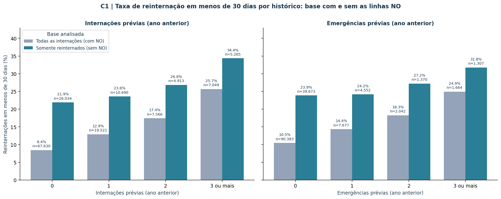

## 8. Storytelling registrado

O percurso segue a ordem da investigação. Primeiro verificamos se a base era confiável: duplicatas, ausências e extremos. Nessa etapa vimos que os "outliers" de histórico eram justamente o grupo de maior risco e decidimos preservá-los. Depois olhamos as distribuições (E1 a E3) e as correlações (E4), que mostraram que as variáveis do período da internação, como permanência, medicamentos e exames, quase não diferenciam os desfechos. A diferença apareceu no histórico de uso do hospital. Então comparamos as proporções por grupo de histórico (X1 e X2), cruzamos os dois históricos e a idade (M1 e M2), testamos a robustez em outras coortes e, por fim, repetimos a análise sem as linhas NO (C1).

O passado hospitalar é o sinal mais claro de reinternação rápida nesta base. Um paciente que esteve internado três ou mais vezes no ano anterior tem cerca de uma chance em quatro de voltar antes de completar um mês da alta. Para quem não teve internação, a chance é de uma em doze. Essa informação já está disponível no momento da admissão.

X1 e X2 usam barras com eixo começando em zero e a mesma escala vertical, para que a altura seja comparável entre os dois históricos. O laranja destaca só o grupo de 3 ou mais, que é a mensagem principal; os demais ficam em cinza (atributo pré-atentivo de cor). Cada barra traz o percentual e o n, para que o leitor não confunda um grupo pequeno com um grupo grande. M1 e M2 usam mapa de calor com escala fixa de 0 a 100% e o denominador em cada célula. O C1 coloca as duas bases lado a lado na mesma escala, para que a mudança de inclinação seja vista de imediato.

Os resultados são descritivos e não provam causa: o histórico pode estar indicando gravidade ou condições crônicas que não estão na base. Um mesmo paciente pode aparecer em várias internações, e por isso não aplicamos testes de significância que suponham independência. NO significa ausência de registro de reinternação nesta rede de hospitais, e não garantia de que o paciente não voltou a outro serviço. Os dados são de 1999 a 2008, de hospitais dos Estados Unidos, e não devem ser generalizados para outros contextos sem cautela. Os grupos de 3 ou mais emergências e algumas células de M1 e M2 têm denominadores pequenos. Com uma linha por paciente, a taxa no grupo de 3 ou mais emergências cai de 24,9% para 16,1% (435 pacientes): o efeito das emergências depende mais de pacientes que se repetem na base do que o das internações.

## 9. Catálogo das seis visualizações principais e notas analíticas

### E1. Distribuição etária

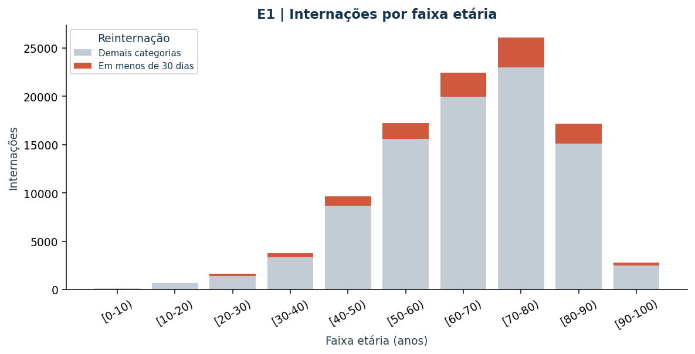

**O que mostra:** Número de internações por faixa etária de dez anos, com a parte de reinternações em menos de 30 dias empilhada em laranja.

**Interpretação:** A base é de pacientes mais velhos: 25,6% das internações estão entre 70 e 80 anos e 81,6% entre 50 e 90. A fatia laranja acompanha o tamanho de cada faixa. A taxa fica entre 9,7% e 12,1% dos 30 aos 100 anos, com pico de 14,2% entre 20 e 30 anos, uma faixa pequena (1.657 internações). A idade, sozinha, não separa bem quem volta rápido.

**Escolha visual:** Barras empilhadas em duas cores mostram o volume de cada faixa e, ao mesmo tempo, a parte que volta em menos de 30 dias. O eixo x segue a ordem natural das faixas, e o laranja é a cor do desfecho de interesse em todo o projeto.

### E2. Permanência por desfecho

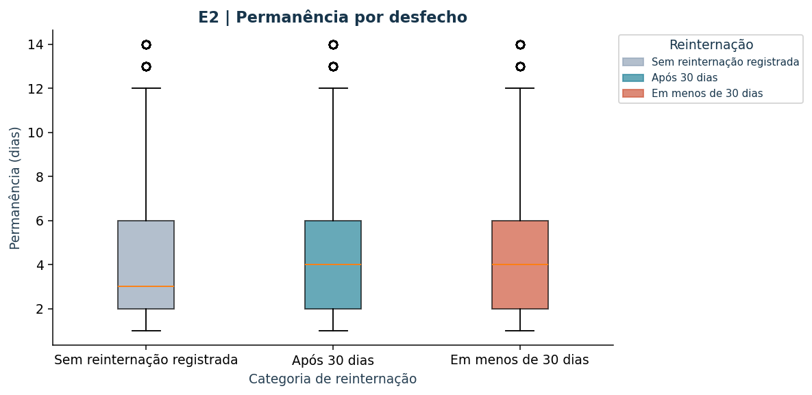

**O que mostra:** Boxplot da permanência hospitalar em dias para cada desfecho: sem reinternação registrada, após 30 dias e em menos de 30 dias.

**Interpretação:** As medianas são quase iguais: 4 dias para <30 e >30 e 3 dias para quem não foi reinternado. As caixas se sobrepõem bastante. A média é um pouco maior em <30 (4,77 dias, contra 4,35 nas demais). A permanência tem relação fraca com a reinternação rápida e não diferencia os grupos tão bem quanto o histórico.

**Escolha visual:** Os três boxplots ficam lado a lado e na mesma escala, para comparar mediana e dispersão. Cada caixa usa a cor do seu desfecho, a mesma dos outros gráficos.

### E3. Medicamentos por internação

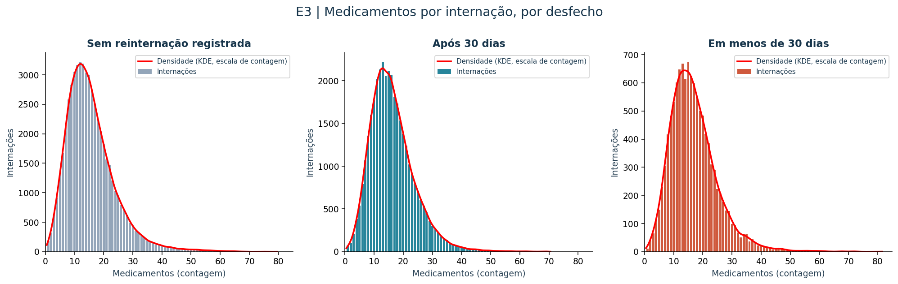

**O que mostra:** Distribuição do número de medicamentos por internação em três painéis, um por desfecho, com a curva de densidade (KDE) em vermelho na escala de contagem.

**Interpretação:** As três distribuições têm a mesma forma: assimétricas à direita, com pico entre 10 e 20 medicamentos e cauda até cerca de 80. A mediana sobe pouco de NO (14) para >30 (15) e <30 (16). Como as alturas refletem o tamanho de cada grupo, o que importa comparar é a forma, e ela quase não muda.

**Escolha visual:** Um painel por desfecho evita sobrepor barras de grupos com tamanhos muito diferentes. A cor de cada painel é a cor do desfecho, e a KDE em vermelho contrasta com as barras para destacar a forma. O eixo x é o mesmo (0 a 85) nos três painéis.

### E4. Correlações por classe do desfecho

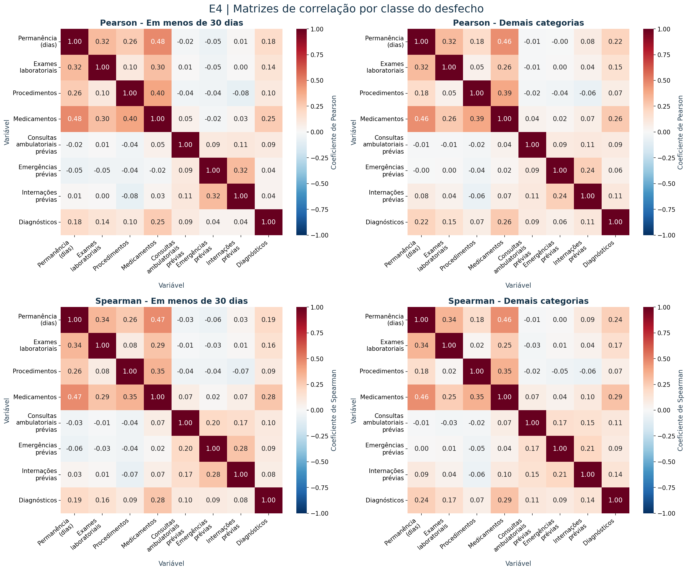

**O que mostra:** Quatro matrizes de correlação entre as oito variáveis numéricas: Pearson e Spearman, calculadas separadamente para <30 dias e para as demais categorias.

**Interpretação:** Nenhuma correlação é forte. A maior é entre permanência e medicamentos (0,46 a 0,48). A diferença mais interessante está entre internações e emergências prévias: a correlação é de 0,32 (Pearson) no grupo <30 e de 0,24 nas demais. Entre quem volta rápido, os dois históricos andam mais juntos, o que motivou o cruzamento M2. Pearson e Spearman dão resultados parecidos, então as conclusões não dependem dos extremos.

**Escolha visual:** Mapa de calor com escala divergente fixa de -1 a 1 (azul negativo, vermelho positivo), igual nos quatro painéis, para que as cores sejam comparáveis. Os valores aparecem em cada célula, porque as diferenças são pequenas.

### X1. Reinternação e internações prévias

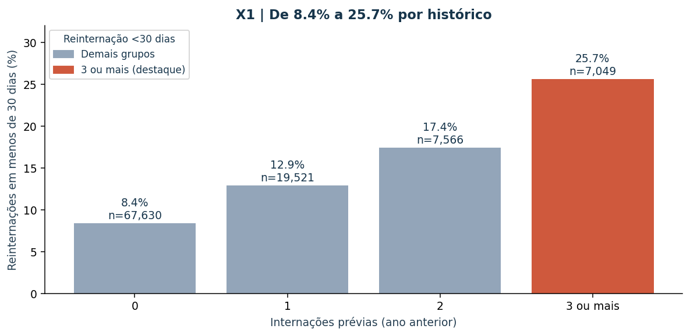

**O que mostra:** Porcentagem de internações que voltaram em menos de 30 dias em cada grupo de internações prévias no ano anterior (0, 1, 2, 3 ou mais), com o n de cada grupo acima da barra.

**Interpretação:** Na base integral: a taxa de reinternação em menos de 30 dias sobe a cada degrau do histórico de internações: 8,4% sem internação prévia, 12,9% com 1, 17,4% com 2 e 25,7% com 3 ou mais. O último grupo tem uma taxa três vezes maior que o primeiro (diferença de 17,2 pontos percentuais), com 7.049 internações no denominador.

**Escolha visual:** As barras começam em zero para que a altura seja proporcional à taxa. Só o grupo de 3 ou mais aparece em laranja, porque é a mensagem principal; os outros ficam em cinza. A escala vertical é a mesma do X2, para comparar os dois históricos.

### X2. Reinternação e emergências prévias

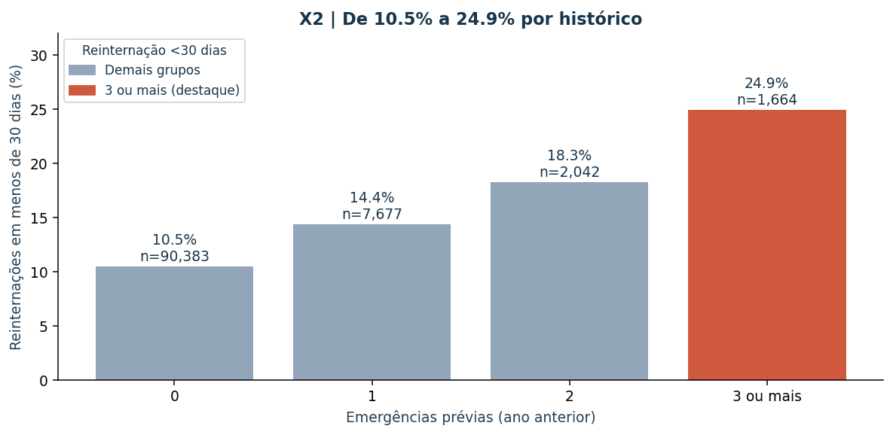

**O que mostra:** Porcentagem de internações que voltaram em menos de 30 dias em cada grupo de emergências prévias no ano anterior (0, 1, 2, 3 ou mais), com o n de cada grupo acima da barra.

**Interpretação:** Na base integral: o mesmo padrão aparece nas emergências: 10,5% sem emergência prévia, 14,4% com 1, 18,3% com 2 e 24,9% com 3 ou mais (diferença de 14,5 pontos). O grupo de 3 ou mais é pequeno (1.664 internações), e 88,8% da base não teve nenhuma emergência no ano anterior.

**Escolha visual:** Mesmo desenho do X1 (eixo em zero, destaque em laranja no 3 ou mais e mesma escala vertical), para que as duas figuras sejam lidas como um par.

## 10. Notas das visualizações complementares

### M1. Idade, histórico e desfecho

Mapa de calor em que as linhas são faixas etárias e as colunas são grupos de internações prévias (0, 1, 2, 3 ou mais). Cada célula mostra a porcentagem de reinternação em menos de 30 dias e o número de internações (n).

Na base integral: em quase todas as faixas etárias, a taxa sobe da esquerda para a direita, de 0 até 3 ou mais internações prévias. Entre 70 e 80 anos, por exemplo, vai de 9,6% para 23,5%. O efeito do histórico não é explicado pela idade. As células mais escuras (41,6% entre 20 e 30 anos com 3 ou mais) têm denominadores pequenos e devem ser lidas com cautela.

A escala de cor é fixa de 0 a 100%, para que a mesma cor signifique a mesma taxa em qualquer recorte. O n aparece em cada célula para que uma célula escura com poucos casos não seja lida como resultado forte.

### M2. Dois históricos simultâneos

Mapa de calor em que as linhas são os grupos de internações prévias e as colunas os grupos de emergências prévias. Cada célula mostra a porcentagem de reinternação em menos de 30 dias e o n.

Na base integral: os dois históricos somam risco. Quem não teve internação nem emergência no ano anterior volta em menos de 30 dias em 8,3% dos casos. Com 3 ou mais internações e 3 ou mais emergências, a taxa é de 33,4% (n=752), quatro vezes maior. As internações prévias pesam mais: sem nenhuma emergência, a taxa já vai de 8,3% para 23,4% quando as internações passam de 0 para 3 ou mais. As emergências acrescentam um efeito menor e menos regular (na linha de 2 internações, a taxa oscila entre 15,2% e 20,5%).

Usamos o mesmo formato e a mesma escala fixa do M1. Cruzar os dois históricos numa única grade permite ver se o risco aumenta quando o paciente tem os dois ao mesmo tempo. O n em cada célula indica onde os grupos são pequenos.

### I1. Exploração interativa

Gráfico de dispersão de duas variáveis numéricas escolhidas no painel, com cor por desfecho. Usa uma amostra de até 4.000 internações.

O gráfico serve para o leitor formular as próprias perguntas no painel. Na maioria dos pares de variáveis, as cores dos desfechos se misturam, o que confirma que nenhuma variável numérica, sozinha, separa quem volta em menos de 30 dias.

Os pontos são semitransparentes para que as áreas com muitas internações apareçam mais escuras. Os eixos podem ser escolhidos no painel para que o leitor teste outras combinações.

### A1. Distribuição acumulada (ECDF) das variáveis numéricas

Distribuição acumulada empírica (ECDF) das oito variáveis numéricas: para cada valor, a proporção de internações com valor menor ou igual a ele.

As curvas de histórico sobem quase até o topo no zero: 66,5% das internações não tiveram internação prévia, 88,8% não tiveram emergência e 83,6% não tiveram consulta ambulatorial. Medicamentos e exames sobem de forma gradual. Cerca de 76% das internações usam até 20 medicamentos.

A ECDF mostra a distribuição inteira sem escolher número de classes e permite ler percentis diretamente no eixo y. Uma curva por painel evita misturar escalas diferentes.

### A2. Distribuições categóricas completas

Frequência de todas as 40 variáveis categóricas (incluindo o desfecho), distribuídas em cinco páginas.

Muitas variáveis de medicamento são quase constantes, e várias categóricas são dominadas por uma única categoria ou por "Não informado". Essas variáveis dão pouca informação para separar os desfechos. As categorias raras, com poucos registros, também seriam um problema para um modelo de machine learning: ele veria poucos exemplos delas e tenderia a aprender ruído. Numa modelagem futura, o caminho seria agrupar as categorias raras em "Outras" e descartar as variáveis quase constantes.

Barras verticais com as sete categorias mais frequentes e o restante agregado em "Outras", só na apresentação. A tabela completa fica no CSV.

### H1. Histogramas numéricos por desfecho - parte 1

Histogramas de permanência, exames laboratoriais, procedimentos e medicamentos, com um painel para cada desfecho.

As formas são parecidas nos três desfechos. As diferenças de altura vêm principalmente do tamanho dos grupos (NO é cerca de cinco vezes maior que <30). Nenhuma dessas quatro variáveis do período da internação mostra um deslocamento claro no grupo <30.

Grade de linhas (variáveis) por colunas (desfechos), com eixo x compartilhado em cada linha. Assim, a comparação entre desfechos é feita na mesma escala horizontal. As cores são as mesmas dos demais gráficos.

### H2. Histogramas numéricos por desfecho - parte 2

Histogramas de consultas ambulatoriais, emergências, internações prévias e diagnósticos, com um painel para cada desfecho.

As três contagens de histórico se concentram no zero, mas a cauda das internações prévias é proporcionalmente mais pesada em <30: 49,8% desse grupo teve ao menos uma internação no ano anterior, contra 24,2% em NO. Os diagnósticos se acumulam no valor 9 em todos os desfechos.

Mesma grade do H1, para manter a leitura consistente. Barras espaçadas deixam claro que as variáveis são contagens discretas.

### Q1. Registros faltantes por atributo

Contagem de registros faltantes por atributo, separada por tipo: marcador "?", Unknown/Invalid, código administrativo sem informação e None nos exames.

O peso falta em quase toda a base (98.569 registros). Especialidade e pagador faltam em cerca de metade e 40% das internações. O None de HbA1c e glicose é o segundo maior volume, mas significa exame não feito, e não dado perdido. Os demais faltantes são pequenos.

Barras horizontais ordenadas da maior para a menor, para ler os nomes dos atributos sem girar o texto. A ordenação cria uma hierarquia visual: o olho começa pelo atributo mais crítico (weight, que falta em quase toda a base) e desce até os menores, sem precisar comparar barras espalhadas. A cor separa o tipo de faltante, porque cada tipo recebe tratamento diferente. Os rótulos trazem a contagem exata.

### Q2. Valores extremos

Um boxplot para cada uma das oito variáveis numéricas, usando todas as internações. Os pontos isolados são os valores além dos limites do IQR.

Em consultas ambulatoriais, emergências e internações prévias, quase todos os pontos acima da caixa são contagens plausíveis de uso do serviço, e não erros. Nas emergências, a caixa vira uma linha no zero. Permanência e procedimentos ficam presos aos limites do domínio. Exames laboratoriais têm alguns valores acima de 96, mas são poucos (0,14%).

Escolhemos o boxplot porque ele mostra diretamente a mediana, os quartis e os pontos que a regra do IQR sinaliza. Cada variável tem seu próprio painel e sua própria escala, porque os intervalos são muito diferentes (0 a 6 procedimentos e até 132 exames).

### A2_1. Distribuições categóricas - página 1

Frequências de race, gender, age, weight, admission_type_id, discharge_disposition_id, admission_source_id e payer_code.

Predominam pacientes Caucasian (74,8%) e mulheres (53,8%). O peso é "Não informado" em 96,9% dos casos. A admissão de emergência (código 1) responde por 53,1% e a alta para casa (código 1) por 59,2%. Em payer_code, "Não informado" (39,6%) supera o Medicare (31,9%).

Barras verticais ordenadas por frequência. Os códigos administrativos aparecem como categorias, e não como números, porque são nominais.

### A2_2. Distribuições categóricas - página 2

Frequências de medical_specialty, diag_1, diag_2, diag_3, max_glu_serum, A1Cresult, metformin e repaglinide.

A especialidade mais comum é "Não informado" (49,1%), seguida de medicina interna (14,4%). Os diagnósticos têm centenas de códigos, e o mais frequente (428, insuficiência cardíaca) não passa de 7%. Glicose e HbA1c não foram medidas em 94,7% e 83,3% das internações. A metformina é usada em cerca de 20%.

A agregação em "Outras" é necessária para os diagnósticos, com mais de 700 códigos cada. Sem ela o gráfico ficaria ilegível.

### A2_3. Distribuições categóricas - página 3

Frequências de nateglinide, chlorpropamide, glimepiride, acetohexamide, glipizide, glyburide, tolbutamide e pioglitazone.

Quase todos os registros são "No". Glipizide (11,2% Steady) e glyburide (9,1%) são os mais usados nesta página. Acetohexamide e tolbutamide praticamente não aparecem.

Mesmo formato das outras páginas, para facilitar a comparação. O eixo y em contagem deixa evidente a dominância do "No".

### A2_4. Distribuições categóricas - página 4

Frequências de rosiglitazone, acarbose, miglitol, troglitazone, tolazamide, examide, citoglipton e insulin.

A insulina é a exceção: só 46,6% "No", com 30,3% Steady, 12,0% Down e 11,1% Up. Examide e citoglipton têm uma única categoria em toda a base, e as outras ficam próximas de 100% "No".

Mesmo formato das outras páginas. Variáveis constantes foram mantidas no gráfico, para documentar que foram verificadas.

### A2_5. Distribuições categóricas - página 5

Frequências das combinações de medicamentos, de change, de diabetesMed e do desfecho readmitted.

As combinações são raríssimas. Houve mudança na medicação de diabetes em 46,2% das internações, e 77,0% receberam algum medicamento para diabetes. O desfecho se divide em 53,9% NO, 34,9% >30 e 11,2% <30.

Mesmo formato das outras páginas. A página termina com o desfecho, que serve de referência para todas as proporções do projeto.

## 11. Catálogo de atendimento aos critérios

| id | criterio | evidencia | onde_encontrar | situacao |
| --- | --- | --- | --- | --- |
| E01 | Exploração - estrutura e tipos | estrutura_atributos.csv (50 atributos) | Notebook: Estrutura; painel: Exploração > Estrutura | Implementado no material; avaliação acadêmica cabe à docente. |
| E02 | Exploração - faltantes e cobertura | mecanismos_ausencia.csv; padroes_ausencia.csv | Notebook: Qualidade; painel: Qualidade | Implementado no material; avaliação acadêmica cabe à docente. |
| E03 | Exploração - inconsistências | auditoria_inconsistencias.csv (54 verificações) | Notebook: Qualidade; relatório: Qualidade | Implementado no material; avaliação acadêmica cabe à docente. |
| E04 | Exploração - outliers | outliers_iqr.csv; figura Q2; extremos simultâneos (medicamentos × internações prévias) | Notebook e painel: Qualidade; relatório: Extremos | Implementado no material; avaliação acadêmica cabe à docente. |
| E05 | Exploração - mecanismo de ausência | Hipóteses por atributo; limites de MCAR/MAR/MNAR | Relatório: Ausências; explicações: decisões D01-D04 | Implementado no material; avaliação acadêmica cabe à docente. |
| E06 | Exploração - tratamento justificado | Preservação de linhas, categorias explícitas e sensibilidades | Relatório: Qualidade; explicações: registro de decisões | Implementado no material; avaliação acadêmica cabe à docente. |
| E07 | Exploração - distribuições completas | descritiva_numerica.csv; frequencias_categoricas.csv; A1 e A2.1-A2.5 | Notebook: Distribuições; painel: seletor de atributos | Implementado no material; avaliação acadêmica cabe à docente. |
| E08 | Exploração - relações com o desfecho | relacoes_com_alvo.csv (47 atributos); Pearson e Spearman | Notebook: Relações; painel: Exploração > Relações | Implementado no material; avaliação acadêmica cabe à docente. |
| E09 | Exploração - relações multivariadas | M1: idade × histórico × alvo; M2: dois históricos × alvo | Notebook, painel e relatório: Relações multivariadas | Implementado no material; avaliação acadêmica cabe à docente. |
| S01 | Storytelling - pergunta e público | Gestores de qualidade e analistas; pergunta explícita | Notebook e painel: Pergunta e narrativa; relatório: Abertura | Implementado no material; avaliação acadêmica cabe à docente. |
| S02 | Storytelling - percurso e mensagem | Qualidade > distribuições > proporções > estratos > X1/X2 | Relatório: Storytelling; explicações: etapas 3-7 | Implementado no material; avaliação acadêmica cabe à docente. |
| S03 | Storytelling - resposta à pergunta | Proporções, diferença em pontos percentuais e limites | Painel: resposta do recorte; relatório: Resposta à pergunta | Implementado no material; avaliação acadêmica cabe à docente. |
| V01 | Visualizações - 4 exploratórias e 2 explanatórias | E1, E2, E3, E4; X1 e X2, com notas individuais | Notebook, relatório e painel | Implementado no material; avaliação acadêmica cabe à docente. |
| V02 | Visualizações - escolhas e atributos pré-atentivos | Justificativas por figura: posição, cor, escala, agregação | Notas analíticas; relatório: catálogo visual | Implementado no material; avaliação acadêmica cabe à docente. |
| V03 | Visualizações - títulos, eixos, legendas e escalas | Identificação explícita; eixos percentuais com zero; escalas compartilhadas | Figuras E1-E4 e X1-X2; testes de estrutura | Implementado no material; avaliação acadêmica cabe à docente. |
| V04 | Dashboard - organização e interação | Abas, filtros interligados, eixos configuráveis e exportação | src/parte_especifica/dashboard.py | Implementado no material; avaliação acadêmica cabe à docente. |
| N01 | Notas analíticas | O que mostra, interpretação e escolha visual por figura | notas_analiticas.json; relatório; painel: Notas e catálogo | Implementado no material; avaliação acadêmica cabe à docente. |
| N02 | Relatório analítico | Documento com método, evidências, gráficos e resposta à pergunta | relatorio.pdf e relatorio.md | Implementado no material; avaliação acadêmica cabe à docente. |
| R01 | Rastreabilidade e execução | Tabelas, SHA-256 da fonte, scripts, dependências e verificações | explicacao.md; resumo.json; validacao.json; README.md | Implementado no material; avaliação acadêmica cabe à docente. |

Os pesos da Parte Específica totalizam 6,0 pontos. O mapa registra evidências entregues, sem estimar nota ou certificar decisões acadêmicas da docente.

## 12. Limitações e referências

Os resultados são descritivos e não provam causa: o histórico pode estar indicando gravidade ou condições crônicas que não estão na base. Um mesmo paciente pode aparecer em várias internações, e por isso não aplicamos testes de significância que suponham independência. NO significa ausência de registro de reinternação nesta rede de hospitais, e não garantia de que o paciente não voltou a outro serviço. Os dados são de 1999 a 2008, de hospitais dos Estados Unidos, e não devem ser generalizados para outros contextos sem cautela. Os grupos de 3 ou mais emergências e algumas células de M1 e M2 têm denominadores pequenos. Com uma linha por paciente, a taxa no grupo de 3 ou mais emergências cai de 24,9% para 16,1% (435 pacientes): o efeito das emergências depende mais de pacientes que se repetem na base do que o das internações.

## Declaração de uso de IA

Ferramenta utilizada: Claude (Anthropic), usado como assistente de código e de redação. O que foi gerado com IA na Parte Específica: (1) os trechos de código marcados com "[IA] Claude": tabelas auxiliares, ajustes de gráficos, heatmaps de ausência, extremos simultâneos e a comparação C1; (2) a redação dos textos analíticos (src/parte_especifica/textos_grupo.py), incluindo as notas de cada gráfico. O grupo revisou os textos e conferiu os números citados. O que foi decidido e feito pelo grupo: o dataset original tratava do absenteísmo no trabalho. No entanto, a professora reenviou o e-mail a um dos membros, detalhando alguns problemas que o dataset poderia apresentar, como o pequeno número de pessoas, o que resultaria em variáveis repetidas em várias instâncias. Diante disso, outro membro sugeriu um dataset substituto, sobre diabetes. As perguntas foram formuladas de modo a não seguir um único caminho: a análise segue direções diferentes conforme os valores encontrados e as condições necessárias para chegar a cada resultado. Verificação: todos os números citados podem ser reproduzidos executando o notebook. O grupo revisou os resultados e se responsabiliza pelo conteúdo entregue. Todos os integrantes sabem explicar cada parte do trabalho. A declaração completa, que também cobre a Parte Comum e traz as assinaturas, está em docs/DECLARACAO_IA.pdf.

[1] Clore, J.; Cios, K.; DeShazo, J.; Strack, B. (2014). Diabetes 130-US Hospitals for Years 1999-2008. UCI. DOI: 10.24432/C5230J. https://archive.ics.uci.edu/dataset/296/diabetes-130-us-hospitals-for-years-1999-2008

[2] Strack, B. et al. (2014). Impact of HbA1c Measurement on Hospital Readmission Rates. DOI: 10.1155/2014/781670. https://pmc.ncbi.nlm.nih.gov/articles/PMC3996476/
